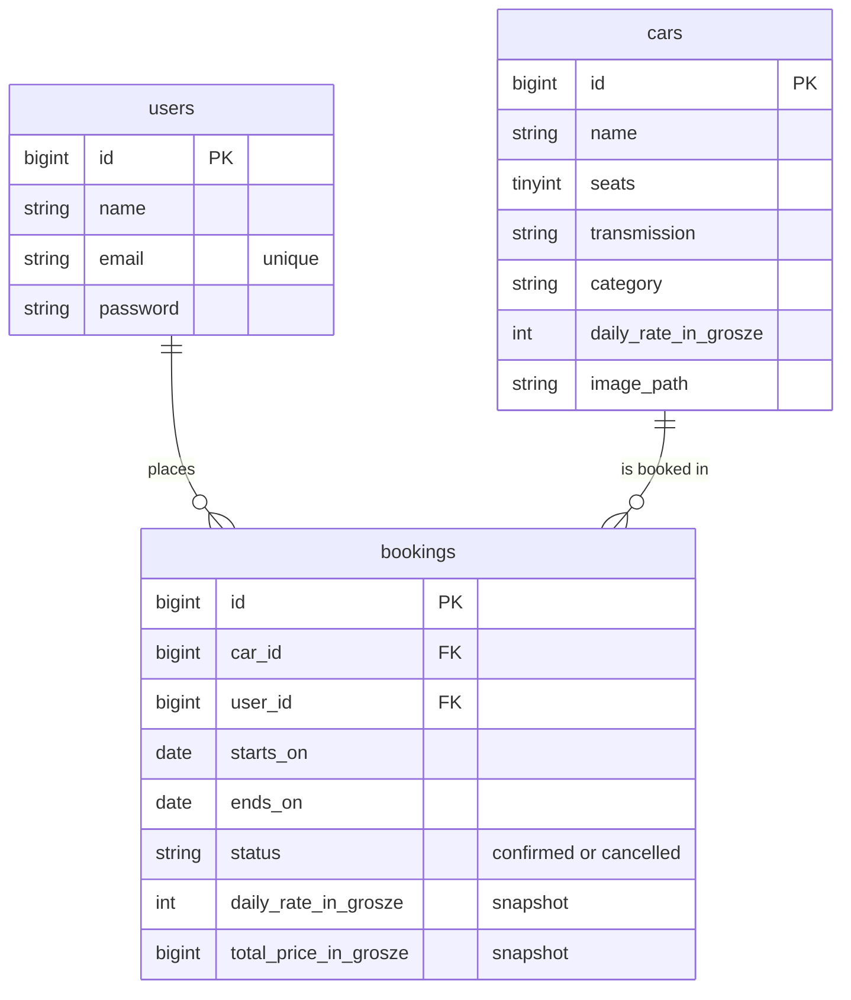

> English version: [README.md](README.md)

# DriveBook

[](https://github.com/MKabaja/DriveBook/actions/workflows/tests.yml)
[](https://github.com/MKabaja/DriveBook/actions/workflows/phpstan.yml)
[](https://github.com/MKabaja/DriveBook/actions/workflows/pint.yml)
[](https://github.com/MKabaja/DriveBook/actions/workflows/frontend.yml)


Rezerwacja aut jednej wypożyczalni: JSON API w Laravelu i SPA w React.

## O projekcie

DriveBook pozwala przejrzeć flotę, sprawdzić cenę auta na wybrany termin i zarezerwować je przez checkout z symulowaną płatnością. Gość loguje się dopiero wtedy, gdy jest to potrzebne, a zalogowany użytkownik widzi własne rezerwacje i może je anulować.

To projekt portfolio fullstack. Domena jest celowo niewielka, żeby uwaga szła na miejsca, w których łatwo o błąd: daty kalendarzowe i strefy czasowe, dokładne ceny, dwie osoby rezerwujące to samo auto w tej samej chwili oraz bezpieczna sesja w przeglądarce.

## Funkcje

- Publiczny katalog z filtrami terminu, minimalnej liczby miejsc i skrzyni. Filtry i paginacja są w URL.
- Szczegóły auta z ceną za wybrany termin, a gdy auto jest zajęte, z kolejnym wolnym terminem tej samej długości, zaczynającym się do 30 dni po żądanym odbiorze.
- Logowanie dopiero wtedy, gdy jest potrzebne: gość loguje się lub zakłada konto na stronie checkoutu.
- Checkout z płatnością demo, bez prawdziwej bramki.
- Własne rezerwacje z anulowaniem do 10:00 w dniu odbioru.

## Stos

| Obszar   | Narzędzia                                                                                |
| -------- | ---------------------------------------------------------------------------------------- |
| Backend  | PHP 8.5, Laravel 13, Sanctum 4 (sesyjne SPA), MySQL 8.4, Laravel Sail                    |
| Frontend | React 19, TypeScript 6 (strict), Vite 8, TanStack Router, Zod 4, Tailwind CSS 4, Motion  |
| Jakość   | Pest 4, Larastan poziom 6, Pint, Vitest, Testing Library, MSW, Biome 2, GitHub Actions   |

## Uruchomienie

Potrzebujesz Dockera i Node 24 (zobacz `frontend/.nvmrc`). Porty 8000, 3306, 5173 i 5174 muszą być wolne.

```bash
git clone https://github.com/MKabaja/DriveBook.git
cd DriveBook
cp .env.example .env

# vendor/ nie jest w repo, a to w nim znajduje się Sail
docker run --rm -u "$(id -u):$(id -g)" -v "$(pwd):/app" -w /app \
    composer:2 composer install --ignore-platform-reqs

./vendor/bin/sail up -d --wait
./vendor/bin/sail artisan key:generate
./vendor/bin/sail artisan migrate --seed
./vendor/bin/sail artisan storage:link

npm --prefix frontend ci
npm --prefix frontend run dev
```

Otwórz <http://localhost:5174>. Vite przekazuje `/api`, `/sanctum` i `/storage` do Laravela na porcie 8000, więc SPA i API działają pod jednym originem.

Seeder tworzy 18 aut ze zdjęciami i nie tworzy kont, więc zarejestruj się w aplikacji.

Uruchomienie na własnym serwerze opisuje [deploy.md](deploy.md).

### Rozwiązywanie problemów

**`ports are not available` przy `sail up`.** Port zajmuje coś na hoście. Zatrzymaj tę usługę. Dla MySQL możesz zamiast tego ustawić inny `FORWARD_DB_PORT` w `.env`. Port 8000 musi zostać, bo wskazuje na niego proxy Vite.

**`Access denied` dla użytkownika bazy.** MySQL tworzy użytkownika tylko przy pustym wolumenie, więc później zmienione dane są ignorowane. `./vendor/bin/sail down -v` tworzy wolumen od nowa i **usuwa lokalną bazę**. Potem powtórz kroki `sail up` i `migrate --seed`.

**Brak zdjęć aut.** Uruchom `./vendor/bin/sail artisan storage:link` i upewnij się, że seeder się wykonał.

**419 lub 401 zaraz po zalogowaniu.** Otwórz aplikację pod adresem z `SANCTUM_STATEFUL_DOMAINS`, domyślnie `localhost:5174`.

### Zmienne środowiskowe

| Zmienna                    | Opis                                                               |
| -------------------------- | ------------------------------------------------------------------ |
| `APP_KEY`                  | Generowany przez `artisan key:generate`                            |
| `APP_PORT`                 | Port kontenera Laravela, lokalnie `8000`                           |
| `DB_DATABASE`              | Baza deweloperska. Testy zawsze używają `testing`                  |
| `DB_USERNAME`, `DB_PASSWORD` | Dane dostępu do bazy, stosowane przy tworzeniu wolumenu          |
| `FRONTEND_URL`             | Jedyny origin dopuszczony przez CORS                               |
| `SANCTUM_STATEFUL_DOMAINS` | Hosty korzystające z uwierzytelniania sesją                        |
| `SESSION_SECURE_COOKIE`    | Na produkcji `true`, żeby ciasteczko szło tylko przez HTTPS        |

## Reguły domeny

**Daty**

- Wynajem to przedział półotwarty `[starts_on, ends_on)` dat kalendarzowych. Auto zwrócone 12. można odebrać ponownie 12.
- Dwie rezerwacje kolidują, gdy `istniejąca.start < nowa.end AND istniejąca.end > nowa.start`. Liczą się tylko rezerwacje `confirmed`.
- Daty wynajmu i terminy są w strefie `Europe/Warsaw`. Odbiór i zwrot są o 10:00, więc długość wynajmu to różnica dat kalendarzowych, także przy zmianie czasu.
- Odbiór najwcześniej jutro według Warszawy, najpóźniej za 180 dni, a wynajem trwa maksymalnie 30 dób.

**Ceny**

- Kwoty to liczby całkowite w groszach, nigdy `float`.
- Rezerwacja zapisuje snapshot stawki dobowej i sumy, więc zmiana stawki auta nie zmienia starych rezerwacji.
- Klient wysyła wyświetloną stawkę jako `expected_daily_rate_in_grosze`. Gdy stawka się zmieniła, API odpowiada 409, strona pokazuje nową sumę, a rezerwacja idzie dopiero po ponownej płatności.
- POST rezerwacji nigdy nie jest ponawiany automatycznie.

## Checkout demo

Płatność jest symulowana w przeglądarce. Dane karty nie trafiają do API, które dostaje tylko auto, daty i oczekiwaną stawkę.

| Numer karty           | Wynik                                             |
| --------------------- | ------------------------------------------------- |
| `4242 4242 4242 4242` | zaakceptowana                                     |
| `4000 0000 0000 0002` | odrzucona                                         |
| inne numery           | zaakceptowane, gdy 13–19 cyfr przechodzi test Luhna |

Przeterminowana karta jest odrzucana. W pozostałych przypadkach podaj dowolną przyszłą datę `MM/YY`. Gdy rezerwacja nie uda się po zaakceptowanej płatności (409, 422 lub 401), strona informuje, że nie pobrano opłaty.

## Architektura backendu

```text
Route → FormRequest (walidacja) → Controller (HTTP, autoryzacja) → DTO readonly
      → Service (operacja biznesowa, transakcja) → Eloquent → JsonResource
```

- **Osobne API i SPA.** Backend zwraca wyłącznie JSON.
- **Zapis rezerwacji.** Jedna transakcja blokuje wiersz `Car`, sprawdza konflikty i zapisuje rezerwację, zawsze w tej kolejności. Anulowanie najpierw zakłada tę samą blokadę.
- **Pipeline walidatorów.** Reguły rezerwacji to osobne walidatory za jednym interfejsem: kolejność dat, okno odbioru, długość wynajmu, dostępność. Tanie sprawdzenia idą pierwsze, a zapytanie do bazy na końcu.
- **Wyjątki domenowe.** Serwisy nigdy nie dostają żądania ani nie zwracają odpowiedzi. Zmieniona stawka rzuca `DailyRateChanged`, a `bootstrap/app.php` mapuje go na 409.
- **Stałe domeny w jednym miejscu.** Strefa czasowa, godzina odbioru, limity i rozmiary stron są w `config/rental.php`.

## Architektura frontendu

SPA jest podzielone na feature'y. Granic importów pilnuje Biome, więc ich złamanie wywraca lint.

```text
frontend/src/
├── app/            # router i główny layout
├── routes/         # cienkie trasy file-based: walidacja URL, loadery, strażnicy
├── features/
│   ├── auth/       # sesja, formularze logowania i rejestracji, bezpieczne przekierowania
│   ├── bookings/   # checkout, płatność demo, lista rezerwacji i anulowanie
│   ├── cars/       # katalog, filtry, szczegóły auta, dostępność
│   └── landing/
│       # każdy feature: api/, model/, lib/, components/, pages/
├── shared/         # transport, formatowanie, komponenty pól i stanów tras
└── test/           # serwer MSW, fabryki, helpery renderowania
```

`shared/` jest używany przez co najmniej dwa feature'y i nie wie nic o żadnym z nich. Jedyna zależność między feature'ami to `bookings` korzystający z `cars`. Checkout dostaje formularze logowania przez render prop, więc `bookings` nie importuje `auth`.

**Trasy**

| Ścieżka                  | Dostęp      | Strona                                                   |
| ------------------------ | ----------- | -------------------------------------------------------- |
| `/`                      | publiczny   | strona główna                                            |
| `/cars`                  | publiczny   | katalog z filtrami i paginacją                           |
| `/cars/$carId`           | publiczny   | szczegóły, cena i kolejny wolny termin                   |
| `/cars/$carId/checkout`  | publiczny   | podsumowanie, logowanie lub rejestracja na miejscu, płatność demo |
| `/login`, `/register`    | goście      | zalogowani są przekierowywani dalej                      |
| `/bookings`              | zalogowany  | własne rezerwacje; gość trafia na `/login` i wraca       |

**Przepływ danych**

- Każda trasa waliduje parametry wyszukiwania Zodem, a URL przechowuje stan filtrów i paginacji, więc przefiltrowany widok można udostępnić lub odświeżyć.
- Loader trasy pobiera dane strony z `AbortSignal` routera, więc wyjście ze strony anuluje żądanie. Po mutacji `router.invalidate()` przeładowuje dane. Nie ma osobnego cache po stronie klienta.
- Wszystkie żądania idą przez `shared/api/backend.ts`, który dodaje ciasteczka i nagłówek XSRF oraz zamienia błędy na `HttpError` lub `NetworkError`.
- Każdy `*.api.ts` parsuje odpowiedź Zodem, więc nieoczekiwane dane zatrzymują się na granicy i nie docierają do komponentu.

**Błędy i sesja**

- `describeError` zamienia każdą porażkę w jeden komunikat dla użytkownika, a błędy rezerwacji (409, 422, 401) są obsługiwane tam, gdzie użytkownik może zareagować.
- Zalogowany użytkownik jest pobierany raz i zapamiętywany, a potem aktualizowany po zalogowaniu i wylogowaniu.
- Wylogowanie ponawia się raz po nieaktualnym tokenie CSRF.
- Parametr `redirect` po logowaniu przechodzi przez listę dozwolonych ścieżek, więc spreparowany link nie przeniesie użytkownika na inną stronę.

**Dostępność**

- Link „przejdź do treści”, a fokus po każdej nawigacji trafia na główną treść.
- Semantyczne formularze z błędami powiązanymi z polami.
- Animacje respektują `prefers-reduced-motion`.
- Zdjęcia aut to responsywne obrazy WebP w dwóch szerokościach.

## Struktura projektu

```text
├── app/
│   ├── DataTransferObjects/    # readonly obiekty wejścia i wyniku
│   ├── Enums/                  # status rezerwacji, kategoria, skrzynia
│   ├── Exceptions/             # wyjątki domenowe
│   ├── Http/                   # kontrolery, FormRequesty, zasoby JSON
│   ├── Policies/               # kto może anulować rezerwację
│   └── Services/
│       ├── Booking/            # BookingService i pipeline walidatorów
│       └── Cars/               # katalog, ceny, okno wynajmu, terminy alternatywne
├── config/rental.php           # stałe domeny
├── database/                   # migracje, seedery i zdjęcia aut
├── docker/mysql/               # skrypt inicjalizacji MySQL dla Saila
├── frontend/                   # SPA w React
├── tests/
│   ├── Feature/                # testy HTTP i współbieżności na MySQL
│   └── Unit/                   # ceny i terminy alternatywne
└── deploy.md                   # uruchomienie na własnym serwerze
```

## Schemat bazy



`bookings` ma indeks `(car_id, starts_on, ends_on)` pod sprawdzanie konfliktów. Klucze obce blokują usuwanie, więc auta ani użytkownika z rezerwacjami nie da się skasować.

## API

| Metoda i ścieżka                 | Dostęp       | Opis                                                |
| -------------------------------- | ------------ | --------------------------------------------------- |
| `GET /api/cars`                  | publiczny    | katalog: `starts_on`, `ends_on`, `seats` (minimum), `transmission`, `page` |
| `GET /api/cars/{car}`            | publiczny    | szczegóły, z ceną i dostępnością dla podanego terminu |
| `POST /api/register`, `/login`   | publiczny    | tworzy sesję, z limitem żądań                       |
| `POST /api/logout`               | zalogowany   | kończy sesję                                        |
| `GET /api/user`                  | zalogowany   | bieżący użytkownik                                  |
| `GET /api/bookings`              | zalogowany   | własne rezerwacje, z paginacją                      |
| `POST /api/bookings`             | zalogowany   | `car_id`, `starts_on`, `ends_on`, `expected_daily_rate_in_grosze` |
| `PATCH /api/bookings/{id}/cancel`| właściciel   | anuluje rezerwację                                  |

| Status | Kiedy                                                                             |
| ------ | --------------------------------------------------------------------------------- |
| `401`  | brak sesji                                                                        |
| `403`  | cudza rezerwacja                                                                  |
| `404`  | brak rekordu                                                                      |
| `409`  | zmieniona stawka dobowa                                                           |
| `419`  | brak lub nieaktualny token CSRF                                                   |
| `422`  | walidacja, konflikt terminu, złe dane logowania lub odmowa anulowania             |
| `429`  | limit żądań                                                                       |

Błędy mają postać `{ "message": "..." }`, a odpowiedzi 422 dodają `"errors": { "pole": ["komunikat"] }`.

## Decyzje techniczne

**Blokada wiersza auta.** Nakładających się przedziałów dat nie da się wyrazić indeksem unikalnym, więc baza sama nie odrzuci podwójnej rezerwacji. Blokada auta ustawia równoczesne żądania w kolejce. Samo `lockForUpdate()` niczego nie dowodzi, dlatego osobny test na MySQL uruchamia dwa prawdziwe procesy na ten sam termin i oczekuje dokładnie jednej rezerwacji.

**Przedziały półotwarte.** Przy `[start, end)` zwrot i odbiór tego samego dnia nie kolidują, a liczba dób to po prostu różnica dat.

**Ceny w groszach, ze snapshotem.** Liczby całkowite dają dokładną arytmetykę. Snapshot chroni stare rezerwacje przed zmianą, a oczekiwana stawka sprawia, że nikt nie zapłaci ceny, której nie widział.

**Sesje Sanctum zamiast tokenów.** Sesja jest w ciasteczku httpOnly, więc skrypty na stronie nie mają dostępu do poświadczeń. Tokeny bearer są całkowicie wyłączone.

**Loadery routera zamiast biblioteki do pobierania danych.** TanStack Router obsługuje już ładowanie, anulowanie i przeładowanie danych strony, więc TanStack Query byłby tu drugą warstwą robiącą to samo.

**`fetch` zamiast axios.** Jedyny moduł transportu potrzebuje tylko ciasteczek, nagłówka XSRF i typowanych błędów.

## Bezpieczeństwo

- Sesja w ciasteczku httpOnly i SameSite=Lax; każdy zapis wymaga tokenu CSRF.
- Limity: logowanie 5 na minutę dla pary e-mail i IP, rejestracja 3 na minutę z jednego IP.
- Polityka pozwala anulować rezerwację tylko właścicielowi.
- CORS dopuszcza tylko `FRONTEND_URL`.
- Zasoby JSON jawnie wymieniają swoje pola, a 404 nie ujawnia nazw klas modeli.
- Przekierowania po logowaniu przechodzą przez listę dozwolonych lokalnych ścieżek.
- Dane karty zostają w przeglądarce.

## Znane ograniczenia

- Płatność jest symulowana, więc nie ma prawdziwego obciążenia ani zwrotu.
- Jeden oddział wypożyczalni i stała stawka dobowa dla auta.
- Parametr potwierdzenia `?booked=` zostaje w URL po odświeżeniu.

## Scenariusz demo

1. Otwórz katalog i przefiltruj go po terminie, liczbie miejsc i skrzyni.
2. Wejdź w auto. Jeśli nie filtrowano po datach, podaj je i wybierz **Check price**. **Continue to checkout** pojawi się, gdy auto jest wolne w tym terminie.
3. Załóż konto na stronie checkoutu.
4. Zapłać kartą odrzucaną i zobacz, że nic nie zarezerwowano. Zapłać kartą akceptowaną i przejdź do swoich rezerwacji.
5. Załóż drugie konto w innym profilu przeglądarki. Otwórz katalog bez dat, bo filtr terminu ukrywa zajęte auta. Wejdź w to samo auto, podaj ten sam termin i wybierz **Check price**. Auto jest niedostępne, a strona proponuje kolejny wolny termin.
6. Aby zobaczyć zmianę ceny, otwórz checkout Toyoty Yaris na wolny termin, uruchom tę komendę i zapłać. Strona pokaże nową sumę, a rezerwacja pójdzie dopiero po ponownej płatności. Przy powtórce użyj innej stawki:

    ```bash
    ./vendor/bin/sail artisan tinker --execute="App\Models\Car::where('name', 'Toyota Yaris')->update(['daily_rate_in_grosze' => 12900]);"
    ```

7. Anuluj rezerwację na liście rezerwacji.

## Testy i kontrola jakości

100 testów backendu i 142 testy frontendu. Testy backendu działają na MySQL, w bazie `testing` Saila, bo na SQLite zachowanie dat, transakcji i blokad nie byłoby wiarygodne. Testy frontendu używają Vitesta i Testing Library, sieć mockuje MSW, a nieobsłużone żądanie wywraca test.

```bash
./vendor/bin/sail composer check   # Pint (zapisuje pliki), Larastan, Pest
npm --prefix frontend run check    # Biome, TypeScript, Vitest, build
```

Larastan działa na poziomie 6, bez baseline'u.

## Dalszy rozwój

- Prawdziwa bramka płatności: status `pending_payment` z czasową blokadą auta i idempotentny webhook potwierdzający rezerwację.
- Testy end-to-end w przeglądarce w CI.
- Panel administratora floty i rezerwacji oraz potwierdzenia e-mail.
- Edycja rezerwacji, wiele oddziałów i dynamiczne ceny.

Źródła i licencje zdjęć są w `database/seeders/images/SOURCES.md` i `frontend/public/images/SOURCES.md`.
