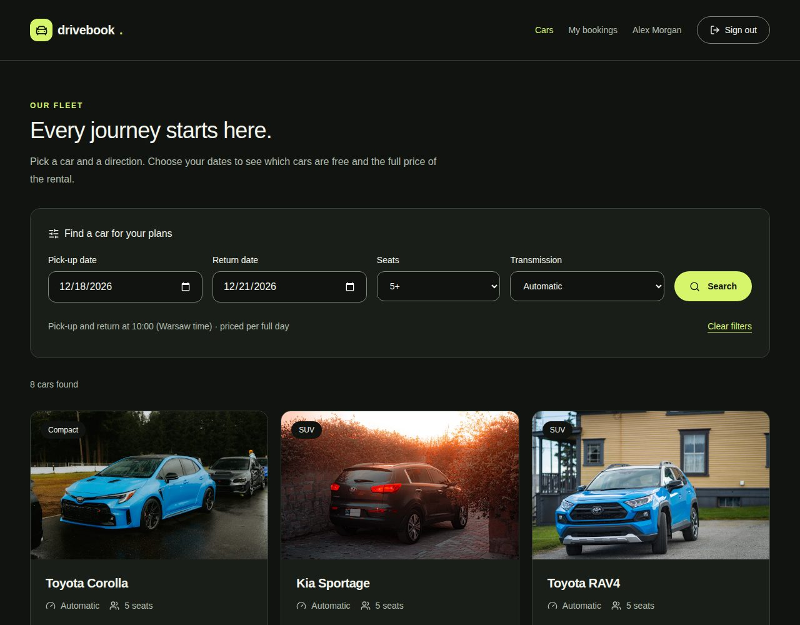
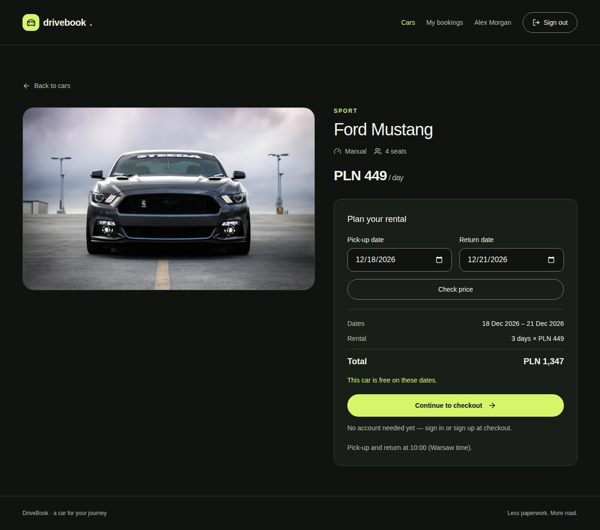
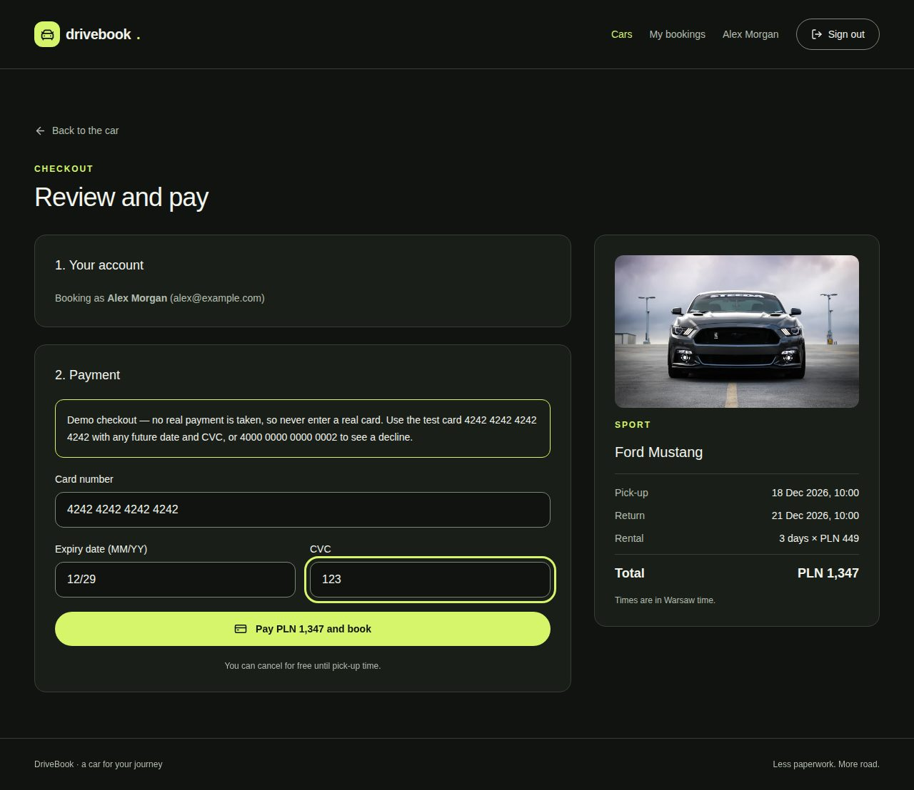
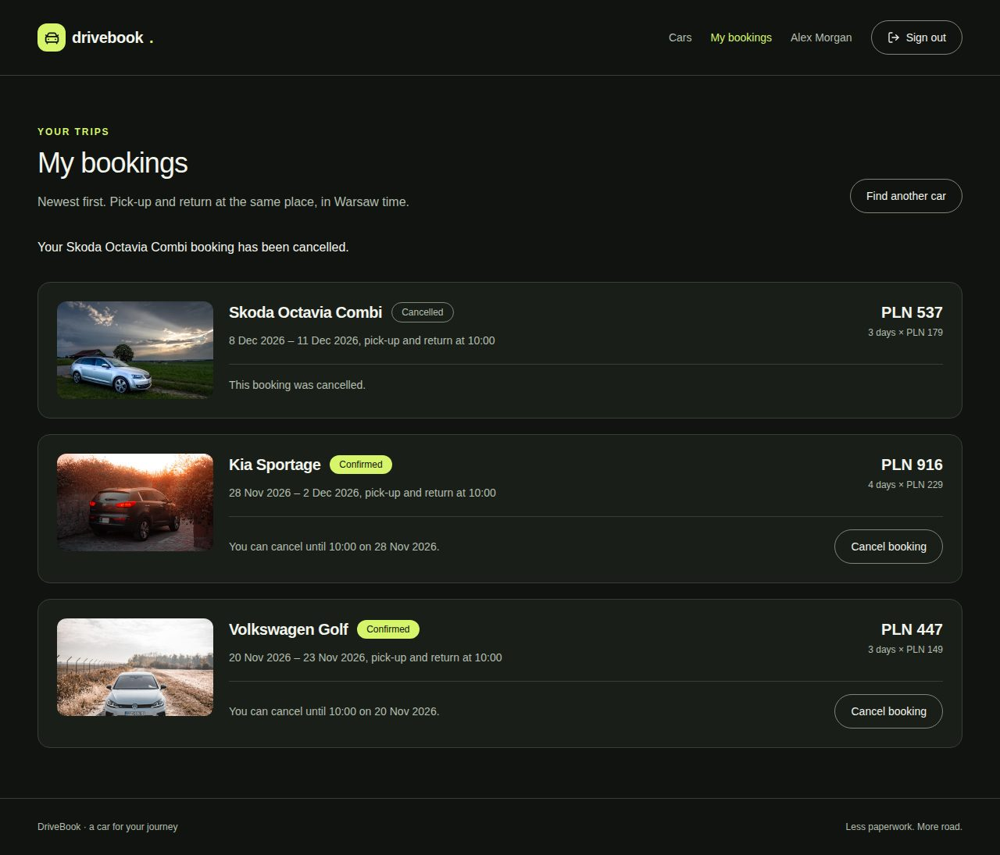

> English version: [README.md](README.md)

# DriveBook

Rezerwacja aut jednej wypożyczalni: publiczny katalog z filtrem terminu, wycena konkretnego auta, checkout z symulowaną płatnością i lista własnych rezerwacji. Projekt portfolio fullstack: JSON API w Laravelu i SPA w React.

## Zrzuty ekranu

| Katalog | Szczegóły auta |
| --- | --- |
|  |  |
| **Checkout** | **Moje rezerwacje** |
|  |  |

## Funkcje

- Publiczny katalog z filtrami terminu, minimalnej liczby miejsc i skrzyni. Filtry i paginacja są w URL.
- Szczegóły auta z ceną za wybrany termin, a gdy auto jest zajęte, z kolejnym wolnym terminem tej samej długości, zaczynającym się do 30 dni po żądanym odbiorze.
- Logowanie dopiero wtedy, gdy jest potrzebne: gość loguje się lub zakłada konto na stronie checkoutu.
- Checkout z płatnością demo, bez prawdziwej bramki.
- Własne rezerwacje z anulowaniem do 10:00 w dniu odbioru.

## Stos

| Obszar   | Narzędzia                                                                                |
| -------- | ---------------------------------------------------------------------------------------- |
| Backend  | PHP 8.5, Laravel 13, Sanctum 4 (sesyjne SPA), MySQL 8.4, Laravel Sail                    |
| Frontend | React 19, TypeScript 6 (strict), Vite 8, TanStack Router, Zod 4, Tailwind CSS 4, Motion  |
| Jakość   | Pest 4, Larastan poziom 6, Pint, Vitest, Testing Library, MSW, Biome 2, GitHub Actions   |

## Uruchomienie

Potrzebujesz Dockera i Node 24 (zobacz `frontend/.nvmrc`). Porty 8000, 3306, 5173 i 5174 muszą być wolne.

```bash
git clone https://github.com/MKabaja/DriveBook.git
cd DriveBook
cp .env.example .env

# vendor/ nie jest w repo, a to w nim znajduje się Sail
docker run --rm -u "$(id -u):$(id -g)" -v "$(pwd):/app" -w /app \
    composer:2 composer install --ignore-platform-reqs

./vendor/bin/sail up -d --wait
./vendor/bin/sail artisan key:generate
./vendor/bin/sail artisan migrate --seed
./vendor/bin/sail artisan storage:link

npm --prefix frontend ci
npm --prefix frontend run dev
```

Otwórz <http://localhost:5174>. Vite przekazuje `/api`, `/sanctum` i `/storage` do Laravela na porcie 8000, więc SPA i API działają pod jednym originem.

Seeder tworzy 18 aut ze zdjęciami i nie tworzy kont, więc zarejestruj się w aplikacji.

## Reguły domeny

**Daty**

- Wynajem to przedział półotwarty `[starts_on, ends_on)` dat kalendarzowych. Auto zwrócone 12. można odebrać ponownie 12.
- Dwie rezerwacje kolidują, gdy `istniejąca.start < nowa.end AND istniejąca.end > nowa.start`. Liczą się tylko rezerwacje `confirmed`.
- Daty wynajmu i terminy są w strefie `Europe/Warsaw`. Odbiór i zwrot są o 10:00, więc długość wynajmu to różnica dat kalendarzowych, także przy zmianie czasu.
- Odbiór najwcześniej jutro według Warszawy, najpóźniej za 180 dni, a wynajem trwa maksymalnie 30 dób.

**Ceny**

- Kwoty to liczby całkowite w groszach, nigdy `float`.
- Rezerwacja zapisuje snapshot stawki dobowej i sumy, więc zmiana stawki auta nie zmienia starych rezerwacji.
- Klient wysyła wyświetloną stawkę jako `expected_daily_rate_in_grosze`. Gdy stawka się zmieniła, API odpowiada 409, strona pokazuje nową sumę, a rezerwacja idzie dopiero po ponownej płatności.
- POST rezerwacji nigdy nie jest ponawiany automatycznie.

## Checkout demo

Płatność jest symulowana w przeglądarce. Dane karty nie trafiają do API, które dostaje tylko auto, daty i oczekiwaną stawkę.

| Numer karty           | Wynik                                             |
| --------------------- | ------------------------------------------------- |
| `4242 4242 4242 4242` | zaakceptowana                                     |
| `4000 0000 0000 0002` | odrzucona                                         |
| inne numery           | zaakceptowane, gdy 13–19 cyfr przechodzi test Luhna |

Przeterminowana karta jest odrzucana. W pozostałych przypadkach podaj dowolną przyszłą datę `MM/YY`. Gdy rezerwacja nie uda się po zaakceptowanej płatności (409, 422 lub 401), strona informuje, że nie pobrano opłaty.

## Architektura

```
FormRequest → Controller → DTO readonly → Service → Eloquent → JsonResource
```

- **Osobne API i SPA.** Backend zwraca wyłącznie JSON.
- **Sesje Sanctum zamiast tokenów.** Sesja jest w ciasteczku httpOnly z ochroną CSRF, więc skrypty na stronie nie mają dostępu do poświadczeń.
- **Brak podwójnych rezerwacji.** Zapis i anulowanie działają w jednej transakcji i zawsze najpierw blokują wiersz `Car`. Zapis potem sprawdza konflikty i tworzy rezerwację. Osobny test na MySQL uruchamia dwa prawdziwe procesy na ten sam termin i oczekuje dokładnie jednej rezerwacji.
- **Pipeline walidatorów.** Reguły rezerwacji to osobne walidatory za jednym interfejsem: kolejność dat, okno odbioru, długość wynajmu, dostępność. Tanie sprawdzenia idą pierwsze, a zapytanie do bazy na końcu.
- **Wyjątki domenowe.** Serwisy nigdy nie dostają żądania ani nie zwracają odpowiedzi. Zmieniona stawka rzuca `DailyRateChanged`, a `bootstrap/app.php` mapuje go na 409.
- **Frontend feature-first.** `frontend/src/features/<feature>/{api,model,lib,components,pages}`, a granice importów pilnuje Biome. W `shared/` jest tylko kod bez wiedzy o feature'ach.
- **Loadery routera zamiast biblioteki do pobierania danych.** Dane stron pochodzą z loaderów TanStack Routera, a stanem filtrów i paginacji jest URL. Każda odpowiedź jest parsowana Zodem.

## API

| Metoda i ścieżka                 | Dostęp       | Opis                                                |
| -------------------------------- | ------------ | --------------------------------------------------- |
| `GET /api/cars`                  | publiczny    | katalog: `starts_on`, `ends_on`, `seats` (minimum), `transmission`, `page` |
| `GET /api/cars/{car}`            | publiczny    | szczegóły, z ceną i dostępnością dla podanego terminu |
| `POST /api/register`, `/login`   | publiczny    | tworzy sesję, z limitem żądań                       |
| `POST /api/logout`               | zalogowany   | kończy sesję                                        |
| `GET /api/user`                  | zalogowany   | bieżący użytkownik                                  |
| `GET /api/bookings`              | zalogowany   | własne rezerwacje, z paginacją                      |
| `POST /api/bookings`             | zalogowany   | `car_id`, `starts_on`, `ends_on`, `expected_daily_rate_in_grosze` |
| `PATCH /api/bookings/{id}/cancel`| właściciel   | anuluje rezerwację                                  |

Błędy: 401 brak sesji, 403 cudza rezerwacja, 404 brak rekordu, 409 zmieniona stawka, 419 CSRF, 422 walidacja, konflikt terminu, złe dane logowania lub odmowa anulowania, 429 limit żądań.

## Scenariusz demo

1. Otwórz katalog i przefiltruj go po terminie, liczbie miejsc i skrzyni.
2. Wejdź w auto. Jeśli nie filtrowano po datach, podaj je i wybierz **Check price**. **Continue to checkout** pojawi się, gdy auto jest wolne w tym terminie.
3. Załóż konto na stronie checkoutu.
4. Zapłać kartą odrzucaną i zobacz, że nic nie zarezerwowano. Zapłać kartą akceptowaną i przejdź do swoich rezerwacji.
5. Załóż drugie konto w innym profilu przeglądarki. Otwórz katalog bez dat, bo filtr terminu ukrywa zajęte auta. Wejdź w to samo auto, podaj ten sam termin i wybierz **Check price**. Auto jest niedostępne, a strona proponuje kolejny wolny termin.
6. Aby zobaczyć zmianę ceny, otwórz checkout Toyoty Yaris na wolny termin, uruchom tę komendę i zapłać. Strona pokaże nową sumę, a rezerwacja pójdzie dopiero po ponownej płatności. Przy powtórce użyj innej stawki:

    ```bash
    ./vendor/bin/sail artisan tinker --execute="App\Models\Car::where('name', 'Toyota Yaris')->update(['daily_rate_in_grosze' => 12900]);"
    ```

7. Anuluj rezerwację na liście rezerwacji.

## Testy i kontrola jakości

Testy backendu działają na MySQL, w bazie `testing` Saila. Na SQLite zachowanie dat, transakcji i blokad nie byłoby wiarygodne.

```bash
./vendor/bin/sail composer check   # Pint (zapisuje pliki), Larastan, Pest
npm --prefix frontend run check    # Biome, TypeScript, Vitest, build
```

## Dalszy rozwój

- Prawdziwa bramka płatności: status `pending_payment` z czasową blokadą auta i idempotentny webhook potwierdzający rezerwację.
- Testy end-to-end w przeglądarce w CI.
- Panel administratora floty i rezerwacji oraz potwierdzenia e-mail.
- Edycja rezerwacji, wiele oddziałów i dynamiczne ceny.

Źródła i licencje zdjęć są w `database/seeders/images/SOURCES.md` i `frontend/public/images/SOURCES.md`.
