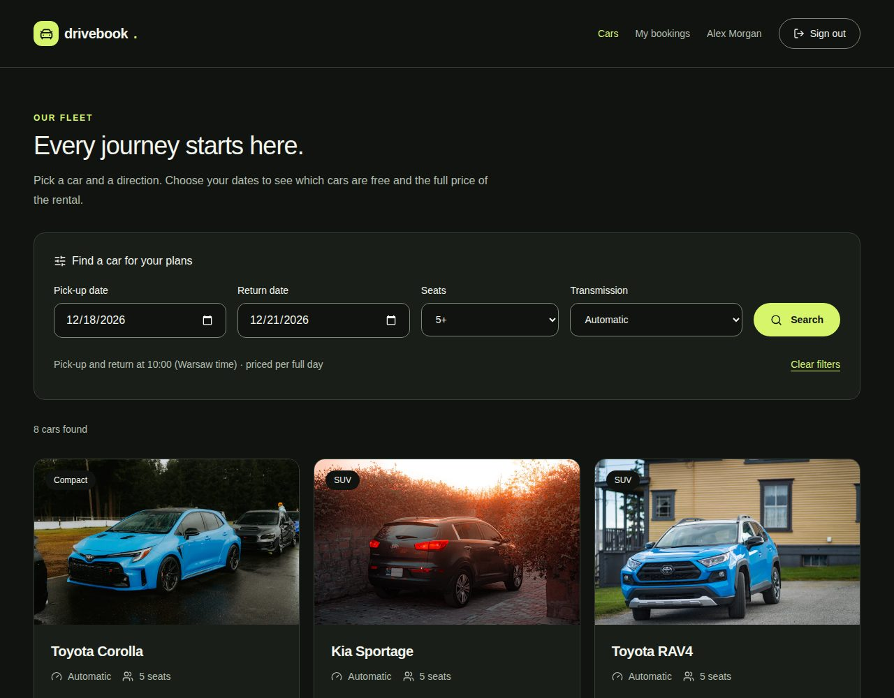
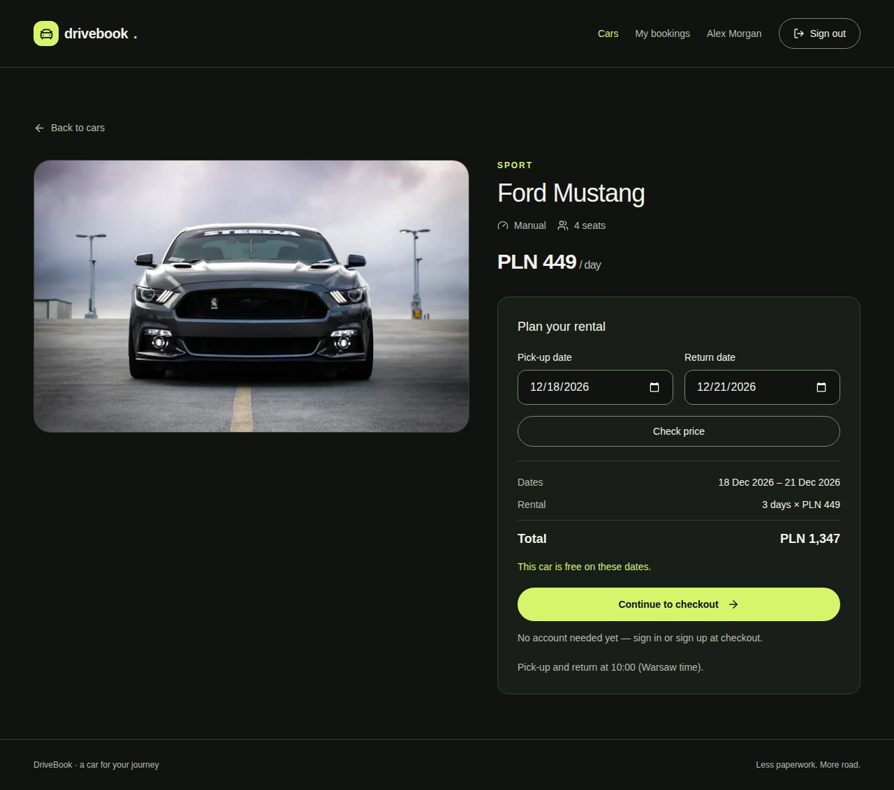
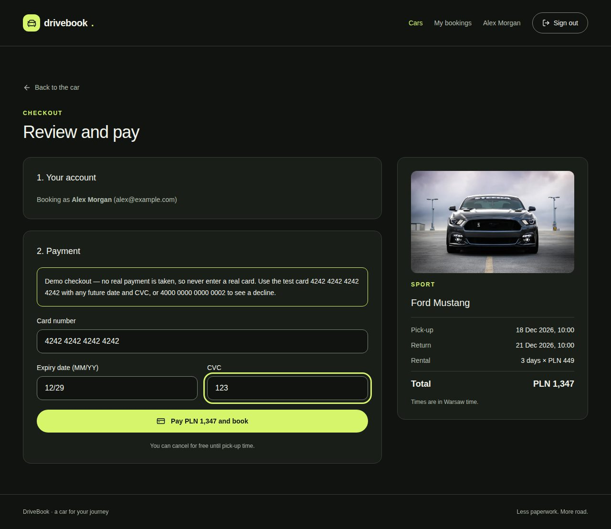
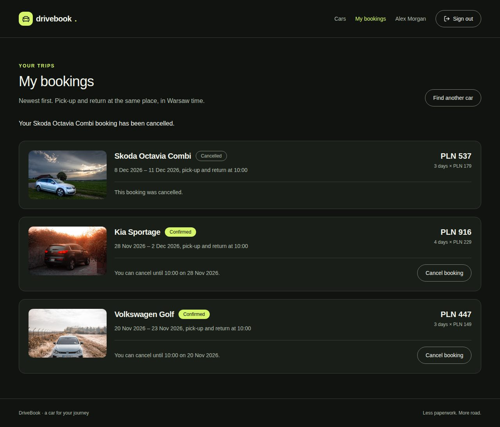

> Polish version: [README-PL.md](README-PL.md)

# DriveBook

Car rental booking for a single rental company: a public catalogue with date filters, per-car pricing, a checkout with a simulated payment, and a list of your own bookings. Built as a fullstack portfolio project, with a Laravel JSON API and a React SPA.

## Screenshots

| Catalogue | Car details |
| --- | --- |
|  |  |
| **Checkout** | **My bookings** |
|  |  |

## Features

- Public catalogue filtered by rental dates, minimum seats and transmission. Filters and pagination live in the URL.
- Car details with a price for the chosen dates and, when the car is taken, the next free period of the same length, starting within 30 days of the requested pickup.
- Sign-in only when it is needed: a guest can sign in or create an account on the checkout page.
- Checkout with a demo payment. No real payment provider is involved.
- Your own bookings, with cancellation until 10:00 on the pickup day.

## Tech stack

| Area     | Tools                                                                                    |
| -------- | ---------------------------------------------------------------------------------------- |
| Backend  | PHP 8.5, Laravel 13, Sanctum 4 (session-based SPA auth), MySQL 8.4, Laravel Sail         |
| Frontend | React 19, TypeScript 6 (strict), Vite 8, TanStack Router, Zod 4, Tailwind CSS 4, Motion  |
| Quality  | Pest 4, Larastan level 6, Pint, Vitest, Testing Library, MSW, Biome 2, GitHub Actions    |

## Getting started

You need Docker and Node 24 (see `frontend/.nvmrc`). Ports 8000, 3306, 5173 and 5174 must be free.

```bash
git clone https://github.com/MKabaja/DriveBook.git
cd DriveBook
cp .env.example .env

# vendor/ is not committed, and Sail itself lives there
docker run --rm -u "$(id -u):$(id -g)" -v "$(pwd):/app" -w /app \
    composer:2 composer install --ignore-platform-reqs

./vendor/bin/sail up -d --wait
./vendor/bin/sail artisan key:generate
./vendor/bin/sail artisan migrate --seed
./vendor/bin/sail artisan storage:link

npm --prefix frontend ci
npm --prefix frontend run dev
```

Open <http://localhost:5174>. Vite proxies `/api`, `/sanctum` and `/storage` to Laravel on port 8000, so the SPA and the API share one origin.

The seeder creates 18 cars with photos and no user accounts, so register one in the app.

## Domain rules

**Dates**

- A rental is a half-open range `[starts_on, ends_on)` of calendar dates. A car returned on the 12th can be picked up again on the 12th.
- Two bookings conflict when `existing.start < new.end AND existing.end > new.start`. Only `confirmed` bookings count.
- Rental dates and deadlines use `Europe/Warsaw`. Pickup and return are at 10:00, so the length of a rental is the difference between calendar dates, also across a DST change.
- The earliest pickup is tomorrow in Warsaw, the latest is 180 days ahead, and a rental lasts at most 30 days.

**Prices**

- Amounts are integers in grosze (1/100 PLN), never floats.
- Each booking stores a snapshot of the daily rate and the total, so changing a car's rate does not alter past bookings.
- The client sends the rate it displayed as `expected_daily_rate_in_grosze`. If the rate has changed, the API answers 409, the page shows the new total, and the booking is sent only after the user pays again.
- The booking POST is never retried automatically.

## Demo checkout

The payment is simulated in the browser. Card data never reaches the API, which receives only the car, the dates and the expected rate.

| Card number           | Result                                            |
| --------------------- | ------------------------------------------------- |
| `4242 4242 4242 4242` | approved                                          |
| `4000 0000 0000 0002` | declined                                          |
| other numbers         | approved if 13–19 digits pass the Luhn checksum   |

An expired card is declined. Use any future `MM/YY` date for the rest. When the booking fails after an approved payment (409, 422 or 401), the page says that no charge was made.

## Architecture

```
FormRequest → Controller → readonly DTO → Service → Eloquent → JsonResource
```

- **Separate API and SPA.** The backend only speaks JSON.
- **Sanctum sessions instead of tokens.** The session sits in an httpOnly cookie with CSRF protection, so scripts on the page cannot read a credential.
- **No double booking.** Saving and cancelling run in one transaction and always lock the `Car` row first. Saving then checks conflicts and writes. A dedicated MySQL test starts two real processes against the same dates and expects exactly one booking.
- **Validation pipeline.** Booking rules are separate validators behind one interface: date order, pickup window, rental length, availability. Cheap checks run first, and the query runs last.
- **Domain exceptions.** Services never receive a request or return a response. A changed rate throws `DailyRateChanged`, and `bootstrap/app.php` maps it to 409.
- **Feature-first frontend.** `frontend/src/features/<feature>/{api,model,lib,components,pages}`, with import boundaries enforced by Biome. `shared/` holds only code without knowledge of any feature.
- **Router loaders instead of a data-fetching library.** Page data comes from TanStack Router loaders, and the URL is the state of filters and pagination. Every response is parsed with Zod.

## API

| Method and path                  | Access       | Description                                         |
| -------------------------------- | ------------ | --------------------------------------------------- |
| `GET /api/cars`                  | public       | catalogue: `starts_on`, `ends_on`, `seats` (minimum), `transmission`, `page` |
| `GET /api/cars/{car}`            | public       | details, with price and availability for given dates |
| `POST /api/register`, `/login`   | public       | creates the session, rate limited                   |
| `POST /api/logout`               | signed in    | ends the session                                    |
| `GET /api/user`                  | signed in    | current user                                        |
| `GET /api/bookings`              | signed in    | your bookings, paginated                            |
| `POST /api/bookings`             | signed in    | `car_id`, `starts_on`, `ends_on`, `expected_daily_rate_in_grosze` |
| `PATCH /api/bookings/{id}/cancel`| owner        | cancels the booking                                 |

Errors: 401 no session, 403 someone else's booking, 404 no such record, 409 changed rate, 419 CSRF, 422 validation, date conflict, wrong login details or a refused cancellation, 429 rate limit.

## Demo scenario

1. Open the catalogue and filter by dates, seats and transmission.
2. Open a car. If you did not filter by dates, enter them and choose **Check price**. **Continue to checkout** appears once the car is free on those dates.
3. Create an account on the checkout page.
4. Pay with the declined card and see that nothing was booked. Pay with the approved card and land on your bookings.
5. Sign up with a second account in another browser profile. Open the catalogue without dates, because a date filter hides booked cars. Open the same car, enter the same dates and choose **Check price**. The car is unavailable and the page suggests the next free period.
6. To see the price change, open a Toyota Yaris checkout for dates that are still free, run this command and pay. The page shows the new total, and the booking is sent only after you pay again. To repeat it, use a different rate:

    ```bash
    ./vendor/bin/sail artisan tinker --execute="App\Models\Car::where('name', 'Toyota Yaris')->update(['daily_rate_in_grosze' => 12900]);"
    ```

7. Cancel a booking on the bookings page.

## Tests and checks

Backend tests run on MySQL, in Sail's `testing` database. Date, transaction and locking behaviour would not be trustworthy on SQLite.

```bash
./vendor/bin/sail composer check   # Pint (writes files), Larastan, Pest
npm --prefix frontend run check    # Biome, TypeScript, Vitest, build
```

## Next steps

- A real payment gateway: a `pending_payment` status with a time-limited hold on the car, and an idempotent webhook that confirms the booking.
- Browser end-to-end tests in CI.
- An admin panel for the fleet and bookings, and email confirmations.
- Editing bookings, multiple branches and dynamic pricing.

Photo sources and licences are listed in `database/seeders/images/SOURCES.md` and `frontend/public/images/SOURCES.md`.
