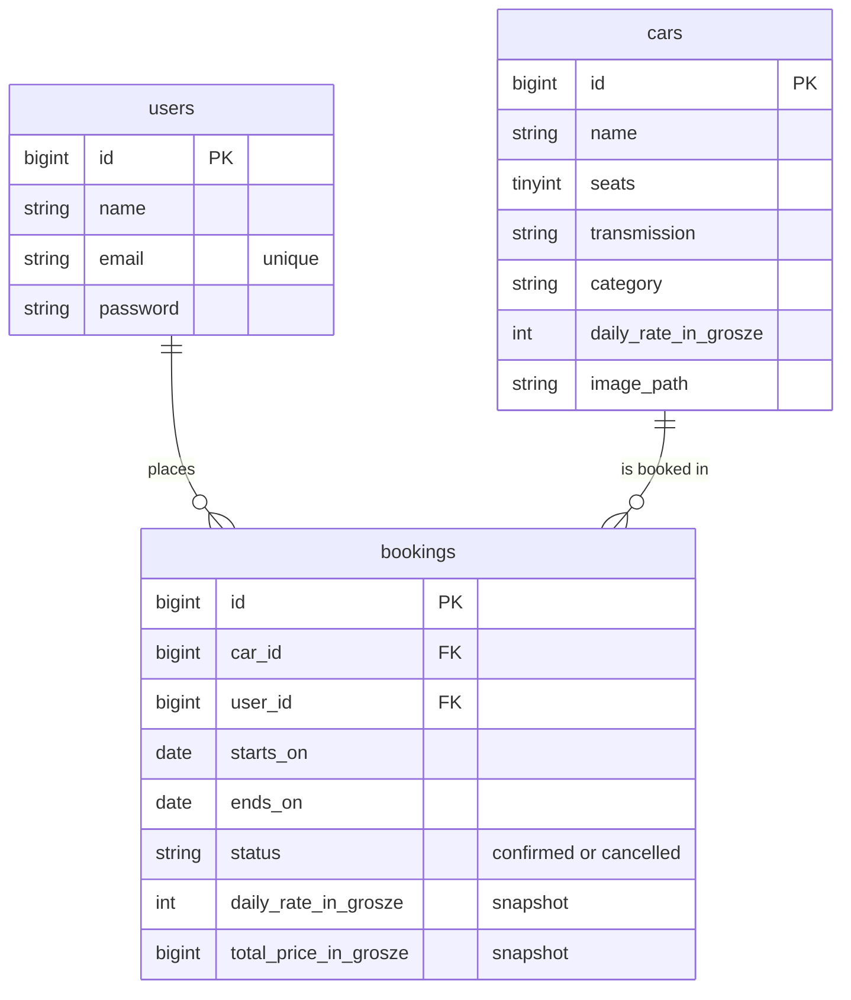

> Polish version: [README-PL.md](README-PL.md)

# DriveBook

[](https://github.com/MKabaja/DriveBook/actions/workflows/tests.yml)
[](https://github.com/MKabaja/DriveBook/actions/workflows/phpstan.yml)
[](https://github.com/MKabaja/DriveBook/actions/workflows/pint.yml)
[](https://github.com/MKabaja/DriveBook/actions/workflows/frontend.yml)


Car rental booking for a single rental company, built as a Laravel JSON API and a React SPA.

## About the project

DriveBook lets a visitor browse a fleet, check the price of a car for chosen dates and book it through a checkout with a simulated payment. A guest signs in only at the moment it is needed, and a signed-in user can see and cancel their own bookings.

It is a fullstack portfolio project. The domain is small on purpose, so the attention goes to the parts that are easy to get wrong: calendar dates across time zones, exact prices, two people booking the same car at the same moment, and a session that stays safe in a browser.

## Features

- Public catalogue filtered by rental dates, minimum seats and transmission. Filters and pagination live in the URL.
- Car details with a price for the chosen dates and, when the car is taken, the next free period of the same length, starting within 30 days of the requested pickup.
- Sign-in only when it is needed: a guest can sign in or create an account on the checkout page.
- Checkout with a demo payment. No real payment provider is involved.
- Your own bookings, with cancellation until 10:00 on the pickup day.

## Tech stack

| Area     | Tools                                                                                    |
| -------- | ---------------------------------------------------------------------------------------- |
| Backend  | PHP 8.5, Laravel 13, Sanctum 4 (session-based SPA auth), MySQL 8.4, Laravel Sail         |
| Frontend | React 19, TypeScript 6 (strict), Vite 8, TanStack Router, Zod 4, Tailwind CSS 4, Motion  |
| Quality  | Pest 4, Larastan level 6, Pint, Vitest, Testing Library, MSW, Biome 2, GitHub Actions    |

## Getting started

You need Docker and Node 24 (see `frontend/.nvmrc`). Ports 8000, 3306, 5173 and 5174 must be free.

```bash
git clone https://github.com/MKabaja/DriveBook.git
cd DriveBook
cp .env.example .env

# vendor/ is not committed, and Sail itself lives there
docker run --rm -u "$(id -u):$(id -g)" -v "$(pwd):/app" -w /app \
    composer:2 composer install --ignore-platform-reqs

./vendor/bin/sail up -d --wait
./vendor/bin/sail artisan key:generate
./vendor/bin/sail artisan migrate --seed
./vendor/bin/sail artisan storage:link

npm --prefix frontend ci
npm --prefix frontend run dev
```

Open <http://localhost:5174>. Vite proxies `/api`, `/sanctum` and `/storage` to Laravel on port 8000, so the SPA and the API share one origin.

The seeder creates 18 cars with photos and no user accounts, so register one in the app.

Running it on your own server is described in [deploy.md](deploy.md) (in Polish).

### Troubleshooting

**`ports are not available` on `sail up`.** Something on the host already uses the port. Stop that service. For MySQL you can instead set another `FORWARD_DB_PORT` in `.env`. Port 8000 has to stay, because the Vite proxy targets it.

**`Access denied` for the database user.** MySQL creates the user only when its data volume is empty, so credentials changed later are ignored. `./vendor/bin/sail down -v` recreates the volume and **deletes the local database**. Run the `sail up` and `migrate --seed` steps again afterwards.

**No car photos.** Run `./vendor/bin/sail artisan storage:link`, and make sure the seeder has run.

**419 or 401 straight after signing in.** Open the app at an address listed in `SANCTUM_STATEFUL_DOMAINS`, by default `localhost:5174`.

### Environment variables

| Variable                   | Description                                                        |
| -------------------------- | ------------------------------------------------------------------ |
| `APP_KEY`                  | Generated by `artisan key:generate`                                |
| `APP_PORT`                 | Port of the Laravel container, `8000` locally                      |
| `DB_DATABASE`              | Development database. Tests always use `testing`                   |
| `DB_USERNAME`, `DB_PASSWORD` | Database credentials, applied when the volume is first created   |
| `FRONTEND_URL`             | The only origin allowed by CORS                                    |
| `SANCTUM_STATEFUL_DOMAINS` | Hosts that get session authentication                              |
| `SESSION_SECURE_COOKIE`    | Set to `true` in production, so the cookie travels only over HTTPS |

## Domain rules

**Dates**

- A rental is a half-open range `[starts_on, ends_on)` of calendar dates. A car returned on the 12th can be picked up again on the 12th.
- Two bookings conflict when `existing.start < new.end AND existing.end > new.start`. Only `confirmed` bookings count.
- Rental dates and deadlines use `Europe/Warsaw`. Pickup and return are at 10:00, so the length of a rental is the difference between calendar dates, also across a DST change.
- The earliest pickup is tomorrow in Warsaw, the latest is 180 days ahead, and a rental lasts at most 30 days.

**Prices**

- Amounts are integers in grosze (1/100 PLN), never floats.
- Each booking stores a snapshot of the daily rate and the total, so changing a car's rate does not alter past bookings.
- The client sends the rate it displayed as `expected_daily_rate_in_grosze`. If the rate has changed, the API answers 409, the page shows the new total, and the booking is sent only after the user pays again.
- The booking POST is never retried automatically.

## Demo checkout

The payment is simulated in the browser. Card data never reaches the API, which receives only the car, the dates and the expected rate.

| Card number           | Result                                            |
| --------------------- | ------------------------------------------------- |
| `4242 4242 4242 4242` | approved                                          |
| `4000 0000 0000 0002` | declined                                          |
| other numbers         | approved if 13–19 digits pass the Luhn checksum   |

An expired card is declined. Use any future `MM/YY` date for the rest. When the booking fails after an approved payment (409, 422 or 401), the page says that no charge was made.

## Backend architecture

```text
Route → FormRequest (validation) → Controller (HTTP, authorization) → readonly DTO
      → Service (business operation, transaction) → Eloquent → JsonResource
```

- **Separate API and SPA.** The backend only speaks JSON.
- **Saving a booking.** One transaction locks the `Car` row, runs the conflict check and writes the booking, always in that order. Cancelling takes the same lock first.
- **Validation pipeline.** Booking rules are separate validators behind one interface: date order, pickup window, rental length, availability. Cheap checks run first, and the query runs last.
- **Domain exceptions.** Services never receive a request or return a response. A changed rate throws `DailyRateChanged`, and `bootstrap/app.php` maps it to 409.
- **One place for domain constants.** The time zone, pickup hour, limits and page sizes live in `config/rental.php`.

## Frontend architecture

The SPA is organised by feature. Biome enforces the import boundaries, so a violation fails the lint step.

```text
frontend/src/
├── app/            # router and root layout
├── routes/         # thin file-based routes: search validation, loaders, guards
├── features/
│   ├── auth/       # session, sign-in and registration forms, safe redirects
│   ├── bookings/   # checkout, demo payment, bookings list and cancellation
│   ├── cars/       # catalogue, filters, car details, availability
│   └── landing/
│       # each feature: api/, model/, lib/, components/, pages/
├── shared/         # transport, formatting, field and route feedback components
└── test/           # MSW server, factories, render helpers
```

`shared/` is used by at least two features and knows nothing about any of them. The only dependency between features is `bookings` using `cars`. Checkout receives the sign-in forms as a render prop, so `bookings` does not import `auth`.

**Routes**

| Path                     | Access      | Page                                                     |
| ------------------------ | ----------- | -------------------------------------------------------- |
| `/`                      | public      | landing page                                             |
| `/cars`                  | public      | catalogue with filters and pagination                    |
| `/cars/$carId`           | public      | details, price and next free dates                       |
| `/cars/$carId/checkout`  | public      | summary, sign-in or registration on the spot, demo payment |
| `/login`, `/register`    | guests      | signed-in users are redirected away                      |
| `/bookings`              | signed in   | own bookings; guests go to `/login` and come back        |

**Data flow**

- Each route validates its search params with Zod, and the URL holds the state of filters and pagination, so a filtered view can be shared or refreshed.
- A route loader fetches the page data with the router's `AbortSignal`, so leaving a page cancels its request. After a mutation, `router.invalidate()` reloads the data. There is no separate client cache.
- All requests go through `shared/api/backend.ts`, which adds cookies and the XSRF header and turns failures into `HttpError` or `NetworkError`.
- Each `*.api.ts` parses the response with Zod, so unexpected data stops at the boundary instead of reaching a component.

**Errors and session**

- `describeError` turns any failure into one user-facing message, and booking errors (409, 422, 401) are handled where the user can act on them.
- The signed-in user is fetched once and remembered, then updated after signing in or out.
- Signing out retries once after a stale CSRF token.
- The `redirect` parameter after sign-in passes through an allow-list, so a crafted link cannot send the user to another site.

**Accessibility**

- A skip link, and focus moves to the main content after each navigation.
- Semantic forms with errors tied to their fields.
- Animations respect `prefers-reduced-motion`.
- Car photos are responsive WebP images in two widths.

## Project structure

```text
├── app/
│   ├── DataTransferObjects/    # readonly input and result objects
│   ├── Enums/                  # booking status, category, transmission
│   ├── Exceptions/             # domain exceptions
│   ├── Http/                   # controllers, FormRequests, JSON resources
│   ├── Policies/               # who may cancel a booking
│   └── Services/
│       ├── Booking/            # BookingService and the validator pipeline
│       └── Cars/               # catalogue, pricing, rental window, alternative dates
├── config/rental.php           # domain constants
├── database/                   # migrations, seeders and car photos
├── docker/mysql/               # MySQL init script for Sail
├── frontend/                   # React SPA
├── tests/
│   ├── Feature/                # HTTP and concurrency tests on MySQL
│   └── Unit/                   # pricing and alternative dates
└── deploy.md                   # running on your own server
```

## Database schema



`bookings` has an index on `(car_id, starts_on, ends_on)` for the conflict check. Foreign keys restrict deletion, so a car or user with bookings cannot be removed.

## API

| Method and path                  | Access       | Description                                         |
| -------------------------------- | ------------ | --------------------------------------------------- |
| `GET /api/cars`                  | public       | catalogue: `starts_on`, `ends_on`, `seats` (minimum), `transmission`, `page` |
| `GET /api/cars/{car}`            | public       | details, with price and availability for given dates |
| `POST /api/register`, `/login`   | public       | creates the session, rate limited                   |
| `POST /api/logout`               | signed in    | ends the session                                    |
| `GET /api/user`                  | signed in    | current user                                        |
| `GET /api/bookings`              | signed in    | your bookings, paginated                            |
| `POST /api/bookings`             | signed in    | `car_id`, `starts_on`, `ends_on`, `expected_daily_rate_in_grosze` |
| `PATCH /api/bookings/{id}/cancel`| owner        | cancels the booking                                 |

| Status | When                                                                              |
| ------ | --------------------------------------------------------------------------------- |
| `401`  | no session                                                                        |
| `403`  | someone else's booking                                                            |
| `404`  | no such record                                                                    |
| `409`  | the daily rate has changed                                                        |
| `419`  | missing or stale CSRF token                                                       |
| `422`  | validation, date conflict, wrong login details or a refused cancellation          |
| `429`  | rate limit                                                                        |

Errors have the shape `{ "message": "..." }`, and 422 responses add `"errors": { "field": ["message"] }`.

## Technical decisions

**Locking the car row.** Overlapping date ranges cannot be expressed as a unique index, so the database cannot reject a double booking on its own. Locking the car makes concurrent requests for it wait in line. `lockForUpdate()` alone proves nothing, so a dedicated MySQL test starts two real processes against the same dates and expects exactly one booking.

**Half-open date ranges.** With `[start, end)`, a return and a pickup on the same day do not conflict, and the number of rental days is simply the difference between dates.

**Prices as integers, with a snapshot.** Integer grosze keep the arithmetic exact. The snapshot keeps past bookings unchanged, and the expected rate stops anyone from paying a price they did not see.

**Sanctum sessions instead of tokens.** The session sits in an httpOnly cookie, so scripts on the page cannot read a credential. Bearer tokens are switched off entirely.

**Router loaders instead of a data-fetching library.** TanStack Router already handles loading, cancelling and reloading page data, so TanStack Query would be a second layer doing the same job here.

**`fetch` instead of axios.** The single transport module needs only cookies, the XSRF header and typed errors.

## Security

- Session in an httpOnly, SameSite=Lax cookie; every write needs a CSRF token.
- Rate limits: sign-in 5 per minute for an email and IP pair, registration 3 per minute per IP.
- A policy allows only the owner to cancel a booking.
- CORS allows only `FRONTEND_URL`.
- JSON resources list their fields explicitly, and a 404 does not reveal model class names.
- Redirects after sign-in pass through an allow-list of local paths.
- Card data stays in the browser.

## Known limitations

- The payment is simulated, so there is no real charge or refund.
- One rental branch and a fixed daily rate per car.
- The confirmation parameter `?booked=` stays in the URL after a refresh.

## Demo scenario

1. Open the catalogue and filter by dates, seats and transmission.
2. Open a car. If you did not filter by dates, enter them and choose **Check price**. **Continue to checkout** appears once the car is free on those dates.
3. Create an account on the checkout page.
4. Pay with the declined card and see that nothing was booked. Pay with the approved card and land on your bookings.
5. Sign up with a second account in another browser profile. Open the catalogue without dates, because a date filter hides booked cars. Open the same car, enter the same dates and choose **Check price**. The car is unavailable and the page suggests the next free period.
6. To see the price change, open a Toyota Yaris checkout for dates that are still free, run this command and pay. The page shows the new total, and the booking is sent only after you pay again. To repeat it, use a different rate:

    ```bash
    ./vendor/bin/sail artisan tinker --execute="App\Models\Car::where('name', 'Toyota Yaris')->update(['daily_rate_in_grosze' => 12900]);"
    ```

7. Cancel a booking on the bookings page.

## Tests and checks

100 backend tests and 142 frontend tests. Backend tests run on MySQL, in Sail's `testing` database, because date, transaction and locking behaviour would not be trustworthy on SQLite. Frontend tests use Vitest and Testing Library, with the network mocked by MSW, and an unhandled request fails the test.

```bash
./vendor/bin/sail composer check   # Pint (writes files), Larastan, Pest
npm --prefix frontend run check    # Biome, TypeScript, Vitest, build
```

Larastan runs at level 6 with no baseline.

## Next steps

- A real payment gateway: a `pending_payment` status with a time-limited hold on the car, and an idempotent webhook that confirms the booking.
- Browser end-to-end tests in CI.
- An admin panel for the fleet and bookings, and email confirmations.
- Editing bookings, multiple branches and dynamic pricing.

Photo sources and licences are listed in `database/seeders/images/SOURCES.md` and `frontend/public/images/SOURCES.md`.
